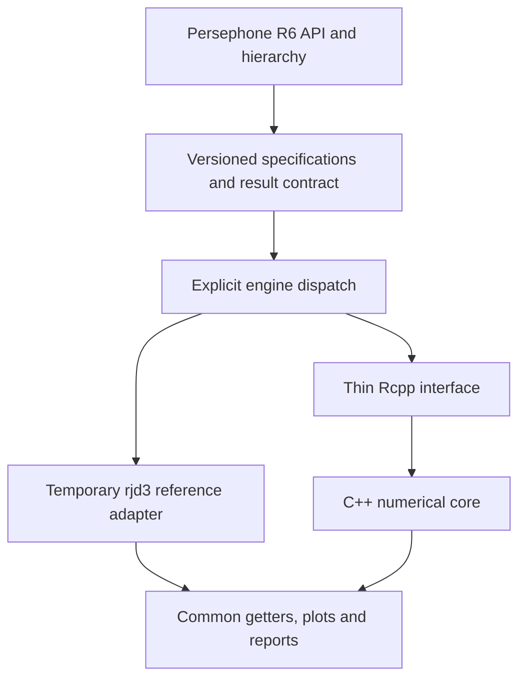

# Implementation status and next-work plan

Updated: **2026-11-13**. Implementation source: current branch (prior checkpoint **`c12299a`**), package **0.1.0**,
branch `codex/implementation-items-1-3`, based on `master` at `463aca8`.
The original reassessment below refers to **`dd38e10`**.

## Assessment

The shared backend adapter, reference corpus and first compiled C++/Rcpp
primitives are implemented. Correctness items **6–13** are delivered for the
current rjd3 path, with **1,387 passing installed-package assertions**. These
cover fitted values, updates, outliers, calendars, hierarchy decisions,
forecasts, reports and dashboard behavior. Each item was committed separately.

**The Java replacement is not complete.** Native code currently provides time
domains, differencing polynomials, convolution, finite filters, and LAPACK-backed
Cholesky/QR linear algebra, transformations, aligned regressor inputs and a
fixed-parameter stationary ARMA/state-space likelihood. It does not
estimate SARIMA models or perform X-11/TRAMO/SEATS adjustment. rjd3 remains the
explicit transitional default; selecting an unsupported native fit fails with
a capability error and never falls back silently. rjd3 packages are optional
dependencies and are no longer loaded when the package itself loads.

Items **16–19** have delivered foundations, **14** has workflow improvements,
**20a.1** delivers a restricted stationary likelihood pilot, and the rest of
**20–27** remains numerical implementation and qualification work. Passing
package checks or primitive tests does not establish native statistical parity.

The assessment below records the `dd38e10` baseline. Subsequent implementation
is tracked in the delivery log, with outstanding gates stated explicitly.
The branch has not been pushed; remote state and CI results for Persephone
were not fetched or verified. Upstream JDemetra+ sources were inspected for
the native-backend plan below.

## Migration delivery log

| Item / slice | Delivered | Validation and remaining scope |
| --- | --- | --- |
| 16a — scope and pinned artifacts | Reproducible inventory of 15 spec blocks/113 setter parameters, 57 output requests, 13 expanded templates, wrapper/JVM metadata and 20 JAR hashes | Actual reference is rjd3/JD+ 3.9.0; see `tools/reference/SCOPE.md`. Release identification is extended in 16b; exact wrapper source revisions, distribution review and full support review remain item 16 gates. No Java implementation or JAR was copied. |
| 16b — release identification and authorship evidence | All 16 installed JD+ 3.9.0 JAR hashes match published Maven artifacts; annotated release tag resolves to `cd50b84773c2bdbf7a067a497954bb6d46cdb81b`, with byte-identical parent POM; per-module numerical provenance | See `tools/reference/NATIVE_PROVENANCE.md`. This identifies the published release, not a reproducible Java build. Exact installed wrapper source revisions and distribution/licence review remain open; no upstream numerical implementation was copied. |
| 17a — shared adapter and additive contracts | Explicit persistent backend selection for singles/batches/hierarchies, lazy rjd3 loading, optional dependencies, serializable spec/result envelopes and stale-fit detection | 260 installed-package R assertions pass, including 43 dashboard checks and direct backend parity. Installed-package loading and capability errors pass with Java-related R packages absent. Native fits remain unimplemented; richer normalized regressors/diagnostics continue in 6/10/12. |
| 18a — direct-backend reference corpus | 12 synthetic fixed/manual AO/automatic fits across X-13/TRAMO-SEATS and monthly/quarterly data; raw outputs, exact field schemas, checksums and per-field comparator | Integrity/corruption tests and all 12 pinned live replays pass. Tolerances are provisional; external-context, missingness, LS/TC, benchmarking, difficult-model and multi-platform cases remain open. |
| 18c — additive reference coverage | Eight separate `extended-v1` direct-backend fixtures for fixed LS/free TC, quarterly internal gaps, fixed/free external regressors and paired future-context shifts; parent corpus preserved | All eight exact pinned replays, 90 independent formula/domain/coefficient/forecast invariants, checksum and corruption checks pass. No tolerance was widened: 229 paths retain provisional rules and one coefficient path remains unreviewed/fail-closed. Full item 18 qualification remains open. |
| 19a — C++17/Rcpp numerical foundations | Registered compiled routines for monthly/quarterly domains, differencing polynomials, convolution and finite filters with explicit missing masks; native-only CI workflow | 58 installed-package Rcpp assertions and standalone strict-warning/ASan/UBSan checks pass locally. Compiled primitives run with Java-related R packages inaccessible. Linux/Windows CI is configured, not remotely verified; no SARIMA estimation or seasonal-adjustment fit is implemented. |
| 19b — numerical linear algebra | Owned column-major matrices; R-supported LAPACK Cholesky solves, log determinants and condition estimates; pivoted QR minimum-norm least squares with rank and original-domain residuals | 114 Rcpp assertions and strict-warning/ASan/UBSan core checks pass. Rank-deficient, underdetermined, zero-rank, ill-conditioned and malformed inputs are covered. OS builds and statistical model qualification remain open. |
| 19c — transformations and model inputs | Mask-preserving identity/log transforms, per-observation log Jacobians and point inverse transforms; serializable monthly/quarterly input contract with full regressor-domain validation | 150 Rcpp/input assertions and standalone transform sanitizers pass. Future/backcast contexts must cover every requested period. No automatic transform selection, estimation-span policy or lognormal mean adjustment is implied. |
| 20a.1 — stationary likelihood pilot | Fixed-parameter scalar-observation state-space and seasonal ARMA likelihood; stationary Lyapunov initialization/stability certificate, Joseph covariance update, explicit missingness, fixed/profile likelihoods and intermediate innovations | 247 R assertions against closed forms, an independent joint Gaussian density and public R Kalman/ARIMA routines; strict C++/sanitizer and cancellation/reuse checks pass. At most 16 states/loading columns; no diffuse states, integrated SARIMA, optimization or native seasonal-adjustment fit. JD+ likelihood conventions remain to be qualified. |
| 8 — specification updates | Template/full-spec replacement, incremental setters, atomic invalid-update handling across batches/nested hierarchies, deep cloning of child lists and documented model-order fixing | 52 focused assertions pass, including recursive/selective changes, mixed-method rejection without partial mutation, canonical-spec imports and stale-result/rerun behavior. F8 is resolved. |
| 6 — outlier extraction and zero-result semantics | Typed date handling, manual/automatic flags from the fitted spec, aggregate direct-spec extraction, fixed/estimated covariance alignment, zero-row no-outlier tables and zero diagnostic counts | 177 extraction assertions pass for both methods and frequencies, AO/LS/TC, fixed coefficients, legacy dates, custom labels, estimation spans and plot consumers. Existing plot/hierarchy tests also pass. F3 is resolved. |
| 11 — calendar regressors | Weighted Easter centering, strict holiday parser/named aliases, deterministic maximum-weight collision handling, locale-independent weekday counts and explicit output/input contracts | 91 calendar assertions pass, including zero/fractional weights, hand-calculated dates, leap years, collisions and quarterly sums. The default 140-year calendar and year boundaries were checked. F6 is resolved; no Java dependency is used. |
| 7 — fixing detected outliers | Current backend setters, preserved manual/fixed effects, frequency-aware protected tails, idempotent and atomic aggregate/recursive/batch updates | 188 focused assertions and four existing fixing checks pass for both methods and frequencies. AO/LS/TC are supported; fitted SO effects fail explicitly. F1 is resolved. |
| 9 — hierarchy arithmetic and weights | Selected-child versus fully indirect aggregation, named/time-aligned weighted means, preserved short weight histories, inherited group totals and guards against stale aggregation inputs | 79 new value/alignment assertions and ten existing hierarchy checks pass, including fitted three-level monthly/quarterly hierarchies. F4/F5 are resolved. Reconstruct hierarchies to replace component data or weights. |
| 12 — shared diagnostics and reports | Typed metric extraction and one set of classification thresholds across API/HTML, corrected regression/residual TD directions, preserved category/quality text and significance-ranked report outliers | 180 focused assertions pass, including boundary values and both methods/frequencies; 163 run without Java. Existing misc/dashboard checks pass. F7 is resolved. Unverified stage-2 filters and undefined relative adjustments are explicitly unavailable. |
| 10 — forecast accessors and domains | Shared plain-data point/error contract, exact direct-backend forecasts, per-field horizons and selected/fully indirect weighted aggregation | 180 forecast assertions pass plus backend/diagnostic regressions. F2 is resolved. Shorter TRAMO error/calendar horizons remain explicit; multiplicative aggregate factors and cross-series uncertainty are unavailable rather than incorrectly summed. |
| 13 — dashboard identities and startup | Opaque node IDs, escaped labels, validated events, persistent table selection, bounded module reuse with refreshed reopened panels, and deadline-bounded HTTP startup probes | 101 identity assertions, 12 probe assertions and 43 existing dashboard checks pass. Browser checks cover literal markup, duplicate leaf labels, sorting, paging, off-page close and reopen without duplicate output bindings. F9 is resolved. |
| 17b — result validation follow-up | Reject contradictory canonical-specification and observed-series frequencies during result normalization | Covered by the backend contract suite; ordinary model construction already rejected the mismatch. |
| 18b — inventory integrity follow-up | Prevent inventory-only writes from invalidating or mislabelling an existing reference corpus; require complete regeneration | Temporary-copy checks confirm rejected commands preserve file hashes/mtimes and full regeneration still passes all 12 corpus checks. The repository corpus was unchanged. |
| 14a — validation workflow corrections | Full CI requires reference dependencies, prints/uploads tinytest logs, adds a Linux PDF-manual lane, aligns coverage/pkgdown to Java 21 and builds non-deploying pkgdown previews for pull requests | Workflow YAML parses locally. Remote runs, minimum-version qualification, pinned-versus-current dependency lanes and coverage thresholds remain open; the native-only lane stays separate. |
| 17c — lazy backend reinitialization | Restore an existing protobuf descriptor database after R's example cleanup detaches its lookup pool; isolate and validate the optional compatibility bridge | 14 fresh-process assertions cover constructor/fit/setter recovery for both methods, namespace reloads, duplicate-pool prevention and incompatible-pool errors; package/native capability loading still initializes no Java. |
| 14b — package check follow-up | Explicit namespace imports, source-package exclusions and corrected executable examples/manual wording | Full examples run successfully; implementation tests total 1,387 across 21 files. The remaining compiler warning comes from the installed R headers, not the independently compiled C++ core. |

Each numbered slice is committed separately. A delivered foundation does not
mean that native X-13/TRAMO-SEATS or the later release gates are complete.

## Completed work from the first implementation pass

| Item | Commit | Delivered scope |
| --- | --- | --- |
| 1 | `d8a742c` | Hierarchical plot forecasts, intervals, and outlier markers; focused tests and manual updates |
| 2 | `f9cb071` | Direct dependency declarations and namespace fixes |
| 3 | `9ba14a3` | README/vignette updates, executable examples, diagnostics navigation |
| 4 | `2d10eb3` | Dashboard HTML/lifecycle tests and startup independent of working directory |
| 5 | `dd38e10` | Full local package checks, PDF-manual fixes, responsive cards, aggregate-panel/reactivity fixes, and plot-color regression tests |

These earlier items are complete within their delivered scope. The later
delivery log records the additional numerical/API corrections and the now
working public forecast contract; the earlier rendering checks alone did not
establish those behaviors.

## Implemented capabilities and confidence

| Area | Present implementation | Current assessment |
| --- | --- | --- |
| X-13 and TRAMO/SEATS | Lazy rjd3 adapter, explicit backend selection, spec/result snapshots | Direct-backend parity and atomic update/rerun checks pass; native fitting is unimplemented |
| Batch/hierarchical processing | Nested selected/fully indirect adjustment, named time-aligned weighted means | Hand-calculated and fitted fixtures pass; component/weight replacement requires reconstruction |
| Forecasts and plotting | Public point/error contract, per-field domains and existing plots | Direct fields match the backend; unsupported aggregate factors/covariance are explicit |
| Calendar regressors | Weighted fixed/Easter holidays, centering and quarterly aggregation | Independent date/count/collision fixtures pass; supported inputs are validated |
| Diagnostics/reports | Shared typed metrics, thresholds, outlier metadata and backend quality | Boundary, raw-reference and HTML values agree; stage-2 Henderson metadata is unavailable |
| Dashboards | Escaped labels, opaque IDs, reusable panels and bounded startup probes | Unit, real-server and browser sort/page/reopen checks pass |
| Native numerical code | C++17/Rcpp domains, filters, transforms, validated inputs, LAPACK algebra and stationary fixed-parameter likelihood | 569 boundary/input assertions and standalone sanitizers pass; no integrated/diffuse models, coefficient estimation or native SA fits; cross-platform execution remains open |
| Documentation/delivery | Updated manuals and CI lanes for reference/native paths | Local validation recorded below; minimum-version qualification and remote workflows remain open |

## What was verified

### Implementation validation

- Installed the compiled package in a temporary library; **1,387 assertions**
  pass across **21 test files**. No reference-backed test was skipped.
- Full `R CMD check --as-cran` executed the examples and tests and rebuilt the
  vignettes, PDF manual and HTML manual successfully. A generated `Rplots.pdf`
  packaging note was corrected by excluding generated example plots. The final
  packaging recheck reports **0 errors, 0 notes and 1 warning**; it omitted the
  already-passing runtime/documentation checks after that exclusion-only change.
  The warning is from the installed R 4.5.2 header `R_ext/Boolean.h`, which uses
  an unknown Clang warning group, `-Wfixed-enum-extension`. No package-level
  warning suppression was added. Final archive verification matched all **180**
  current source/test/documentation files that also occur in the archive.
- All **12 pinned direct-backend replays** and corpus integrity/corruption
  checks pass. The corpus is synthetic and does not copy Java implementation.
- With Java-related R packages inaccessible in an isolated library, package
  loading, capability errors, **58 compiled primitive assertions** and **34
  backend contract assertions** pass.
  This is not a claim that the system JVM was removed or native fitting works.
- Independently compiled the C++ core with strict warnings and ASan/UBSan using
  the local Homebrew Clang toolchain; checks pass.
- Browser checks confirm literal markup labels, separate duplicate-name nodes,
  selection across sorting/paging, off-page close and refreshed reopen, with no
  injected label elements or duplicate output IDs. Local test servers were stopped.
- Artifacts are under `/tmp/persephone-implementation-validation`; browser
  snapshots are under `/tmp/persephone-release-validation/.playwright-cli`.
  Temporary artifacts are evidence, not required repository inputs.

### Previously completed validation, rechecked as evidence

- The retained full `R CMD check` log ends in **Status: OK**: zero errors,
  warnings, and notes, including vignette rebuilding and PDF manual generation.
- The retained installed-package test log reports **144 passing assertions in
  nine files**. Of these, 36 concern hierarchical plotting and 43 dashboards.
- At reassessment, all **56 R source, test, and app files** matched the previously checked
  source archive. The full suite/build was not rerun during this documentation
  reassessment; source had not changed.
- Earlier Playwright checks covered single/comparison dashboards, batch and
  hierarchy selections, monthly/quarterly plots, and a narrower embedded layout.
  Those were rendering and interaction checks, not numerical validation.
- Historical artifacts are in `/tmp/persephone-release-validation`; the normal
  user R library was not modified. These temporary files are not repository
  artifacts and may disappear.

### Original reassessment

Reviewed the core model classes, hierarchy/weight implementation, extraction and
reporting code, calendar utility, dashboard consumers, tests, and workflows.
Ran targeted R probes against the current source using R 4.5.2 and installed
rjd3 packages 3.9.0. The failures below were reproduced locally unless explicitly
marked **source inspection**. Probe scripts/logs are under
`/tmp/persephone-reassessment`; essential inputs and observed results are also
recorded here so the plan does not depend on temporary files.

## Findings at the reassessment baseline

Priority **P1** means a correctness issue to resolve before release sign-off.
**P2** means compatibility, input handling, or delivery hardening. Source
locations refer to `dd38e10` and may move as fixes are implemented.

| ID | Priority | Finding and evidence | Relevant source |
| --- | --- | --- | --- |
| F1 | P1 | After fitting `AirPassengers`, both `perX13(...)$fixOutlier()` and `perTramo(...)$fixOutlier()` fail with `argument is of length zero`. The implementation reads the old `output$regarima` structure. Its hierarchy path also refers to `private` outside an R6 method. | `R/fixOutlier.R:26`, `:78`, `:96` |
| F2 | P1 | Fitted X-13 `$forecasts` and hierarchy `$forecastsDirect` return `NULL` although `output$user_defined$y_f` contains 12 values. `$forecastsIndirect` then fails with `'x' must be an array of at least two dimensions`. | `R/persephone.R:235`, `:239`; `R/perHts.R:461` |
| F3 | P1 | A manually specified `AO` at `1953-07-01` is reported as `autoout = TRUE`; coercing its character specification date to numeric emits an NA warning. Aggregate extraction additionally reads the nested `$params` list rather than `$paramsDirect`. A fitted no-outlier model reports `NA` counts despite backend `regression.nout = 0`. | `R/get_functions.R:143`, `:152`, `:192`; `R/diagnosticsTable.R:223` |
| F4 | P1 | A parent using indirect adjustment ignores a nested child's `indirect = FALSE` choice. It always recurses to the leaves. A non-identical-series fixture differs from the sum of the chosen child results by **36.89045**, while matching fully indirect leaf aggregation exactly. | `R/perHts.R:489`, `:552`, `:558` |
| F5 | P1 | Short time-varying weights are accepted, but their last values replace the entire observation span. With 24 monthly observations, first component values 1 and 101, and 12 months of weights `1:12` and `rep(1,12)`, the first aggregate is **8.692308**, not **51** using the first observed weights. The implementation should preserve aligned history or reject incomplete input. | `R/perHts.R:590`, `:602` |
| F6 | P1 | `genTd(firstYear=2020, lastYear=2021, hd=list("easter+1"), weight=0)` still changes centered weekday regressors by up to **1.593642**. Easter centering does not apply the holiday weight. Additional contract mismatches: documented `NewYearsDay` input errors; `freq=1` silently returns monthly data; returned column counts are 7/6/7 rather than the documented working-day layout. | `R/genTd.R:9`, `:18`, `:237`, `:244`, `:299`, `:305` |
| F7 | P1 | With a controlled regression TD p-value of 0.01, `diagnosticsTable()` returns **Good**, while the single dashboard returns **Bad**. Both dashboard implementations reverse the API rule. The backend categorical seasonality result **Present** is coerced to numeric and displayed as **Undefined**. | `R/diagnosticsTable.R:175`; `R/dashboard_single.R:157`, `:403`; `R/dashboard_compare.R:147`, `:282` |
| F8 | P1 | For both single-series methods, `updateParams(template="rsa0")` leaves an existing `rsa3` specification identical, unlike a fresh `rsa0` object. A hierarchy call with that argument errors with `'what' must be a function or character string`. Template replacement/update semantics are not consistent across classes. | `R/persephone.R:67`; `R/perX13.R:28`; `R/perTramo.R:28`; `R/perHts.R:363` |
| F9 | P2 | A hierarchy component named `Aggregate` yields duplicate UI paths and resolves to the root instead of the child. **Source inspection:** names also enter checkbox HTML with `escape=FALSE`, CSS selectors, and inline JavaScript without context-appropriate escaping. Quotes, markup, and `/` require safe identities independent of display labels. | `inst/app/helpers.R:6`, `:18`; `inst/app/modules/mod_table.R:54`, `:98`; `inst/app/server.R:51` |
| F10 | P2 | **Source inspection:** current CI tests release/devel R, not declared minimum R 4.1; check and coverage jobs use Java 21 and 17 respectively, while pkgdown does not explicitly set up Java. Dependencies resolve moving GitHub refs. The check workflow searches for `testthat` logs although this package uses tinytest. | `DESCRIPTION`; `.github/workflows/check-full.yaml:27`, `:53`, `:136`; `test-coverage.yaml`; `pkgdown.yaml` |

### Minimal reproduction examples

These reproduce failures at the `dd38e10` assessment baseline. Consult the
delivery log for fixes implemented since then; resolved examples no longer
produce the annotated failure. They are not proposed usage patterns.

```r
library(persephone3)

x <- perX13(AirPassengers)
x$run()
x$fixOutlier()                         # currently errors
is.null(x$forecasts)                   # TRUE
length(x$output$user_defined$y_f)      # 12
x$diagnosticsTable()[, c("nOutliers", "nAutoout", "nRecentout")]
# Currently NA rather than zero for this fitted model.

x <- perX13(AirPassengers, template = "rsa3")
before <- x$params
x$updateParams(template = "rsa0")
identical(before, x$params)            # TRUE: requested template was not applied

x <- perX13(AirPassengers, addout.type = "AO", addout.date = "1953-07-01")
x$run()
x$getOutliers()                       # manual AO currently marked automatic

g <- genTd(firstYear = 2020, lastYear = 2021,
           hd = list("easter+1"), weight = 0)
max(abs(g[[3]][, 1:6] - g[[2]]))       # approximately 1.593642, should be 0
```

### Why the baseline tests missed these cases

- `test_fix.R` checks `fixOutlier()` only **before** fitting, then checks that
  the fitted output exists without calling the fixer again.
- Calendar tests assert only that the returned list has three elements.
- Hierarchy tests predominantly assert classes/non-NULL results and time
  spans; they do not assert nested decision semantics or weighted values.
- Forecast plot fixtures use `user_defined$y_f`; they never exercise the public
  forecast bindings that read a different output path.
- Dashboard tests inspect HTML, titles, rendering, and lifecycle behavior, but
  not agreement of displayed numbers/statuses with the diagnostic API.
- The hierarchy test labelled as a known quality-table issue only asserts the
  hierarchy object is non-NULL. It is not evidence of quality-report accuracy.

## Correctness plan and delivery status

The original acceptance criteria are retained below. Items 6–13 have now been
implemented and tested; their delivery details and explicit limitations are in
the log above. Items 14–15 remain broader compatibility/release work. Numerical
backend items 16–27 follow later in this document.

### 6. Normalize outlier extraction and empty-result semantics — delivered

**Addresses:** F3. **Dependencies:** none. **Scope:** `R/get_functions.R`,
`R/diagnosticsTable.R`, their consumers, and new extraction tests.

- Read the direct specification appropriate to the object: single `$params`,
  hierarchical `$paramsDirect`. Normalize supported date representations using
  explicit type handling, without coercing ISO strings to numbers.
- Give no-outlier results a stable typed representation, preferably a zero-row
  table. Reserve missing/unknown values for genuinely unavailable information.
  Update existing plot/report consumers together to avoid breaking their
  `all(is.na(...))` and `$date` assumptions.
- Recheck fixed/estimated regression coefficient mapping, standard errors, and
  recent-outlier boundaries against the installed backend structures.

**Acceptance:** manual AO/LS/TC entries are not labelled automatic for either
method, monthly/quarterly data, or aggregate objects; zero-outlier counts are
zero; no coercion warnings; fixed coefficients have documented uncertainty
fields; legacy/current supported date representations have explicit fixtures.

### 7. Migrate `fixOutlier()` to the current backend — delivered

**Addresses:** F1. **Depends on:** 6. **Scope:** `R/fixOutlier.R`, method wrappers,
manual, and `test_fix.R`.

- Replace legacy result paths and `usrdef.*` updates with the supported rjd3
  extraction/setter path behind the adapter in item 17. Express the operation
  through the common specification contract so it also works with the native
  engine. Remove free-function references to R6 `private`.
- Define whether the protected tail is measured in months or observations;
  the current documentation says months while indexing uses observations.
  Convert quarterly windows explicitly and validate zero/negative/oversized
  spans.
- Preserve existing manual outliers, add eligible detected entries once, and
  limit re-detection to the intended tail. Define aggregate-only versus
  recursive behavior rather than relying on incidental default propagation.

**Acceptance:** run → fix → rerun succeeds for X-13 and TRAMO/SEATS; eligible
outliers remain specified, recent ones remain eligible for detection, repeated
fixing is idempotent, and no-outlier/disabled-detection cases work. Include
monthly and quarterly, single and hierarchical cases with actual fitted data.

### 8. Make specification updates explicit and consistent — delivered

**Addresses:** F8; model-maintenance semantics. **Dependencies:** none for the
basic update fix; reuse item 6 fixtures where relevant.

- Specify and implement the difference between replacing a template, replacing
  a complete specification, and applying incremental parameter changes.
  Validate supported templates/blocks before mutating any object. Define these
  rules once in the versioned specification contract from item 17.
- Apply consistent behavior to single, batch, aggregate-only, recursive, and
  selected-component updates. Do not silently ignore `template` or forward it
  to a nonexistent setter.
- Decide and document how changed specifications mark existing results stale.
  Today outputs remain available unchanged until rerun; distinguish this state
  from a fit for the current settings without silently changing the public API.
- Clarify whether `fixModel()` freezes ARIMA orders or coefficients. Its code
  sets orders and disables automatic selection; the manual currently promises
  that parameters will not be re-estimated. Test the chosen contract.

**Acceptance:** `rsa3` → `rsa0` matches a fresh `rsa0` baseline when replacing a
specification; unrelated settings survive incremental updates; invalid updates
leave the prior state intact; recursive/selective updates touch only intended
nodes; rerun/state behavior and model-fixing behavior are tested and documented.

### 9. Correct hierarchy decisions and weight alignment — delivered

**Addresses:** F4/F5. **Dependencies:** none; specification tests from 8 help
construct differentiated model fixtures. **Scope:** aggregation in `R/perHts.R`.

- Separate fully indirect leaf aggregation from aggregation of each child's
  selected direct/indirect result. Honor a nested child's decision for the
  latter; keep both operations explicit.
- Align weights by actual time index. Preserve supplied historical values and
  either reject incomplete histories or implement a documented extension rule.
  Carrying the last value forward must not overwrite earlier weights.
- Resolve the documentation's weighted-sum language versus the implementation's
  `weighted.mean`. Choose a stable contract for index aggregation and explain
  nesting and normalization; do not silently switch arithmetic.
- Validate dimensions, frequency, named-column alignment, missing/nonfinite
  weights, and zero total weight. Define whether public weight/component
  mutation is supported; if it is, recompute aggregate state consistently.

**Acceptance:** hand-computable weighted/unweighted fixtures agree numerically;
three-level mixed decisions produce the expected selected-child aggregate;
fully indirect results remain distinct where appropriate; the short-weight
reproduction either gives 51 initially or fails clearly before calculation;
monthly/quarterly and mismatched-span cases are covered.

### 10. Restore the public forecast API — delivered

**Addresses:** F2. **Depends on:** 9 for indirect aggregation.

- Define/document what each public forecast field returns: original, adjusted,
  and/or trend forecasts, with stable names, class, frequency, and time span.
  Use supported current backend fields instead of `output$final$forecasts`.
- Make single, batch, direct hierarchy, and indirect hierarchy accessors agree
  on that contract. Handle an unavailable/zero horizon explicitly.
- Align future weights under the policy from 9. Keep forecast points separate
  from uncertainty: do not sum standard errors/intervals without a justified
  covariance assumption.

**Acceptance:** actual X-13/TRAMO-SEATS monthly/quarterly fits expose forecasts
matching requested backend series; indirect points equal independently
aggregated component points; forecast dates/horizons are correct; pre-run,
missing-output, mixed-horizon, and weighted cases have defined behavior.

### 11. Validate and correct calendar regressors — delivered

**Addresses:** F6. **Dependencies:** none; can proceed independently of 6–10.

- Apply holiday weights consistently to observed counts and Easter centering.
  Verify exact/approximate distributions with small, independently calculated
  calendars, including duplicate dates and fixed/Easter holiday collisions.
- Replace `eval(parse(...))` with a strict Easter-offset parser and date
  arithmetic. Validate year order, supported frequency, holiday syntax, and
  weight length/values.
- Either implement named holidays or remove that unsupported promise through
  an explicit compatibility decision. Reconcile output documentation with the
  actual raw counts, six contrasts, and leap-year column; do not imply a working
  day regressor that is absent.

**Acceptance:** zero weight has zero calendar effect; fractional weights scale
corrections appropriately; leap-year and quarterly sums are correct; duplicate
holiday handling is deterministic; invalid inputs fail clearly; output shape,
column meaning, and results are tested under more than one locale.

### 12. Unify numerical diagnostics and reporting — delivered

**Addresses:** F7 and downstream F3 effects. **Depends on:** 6.

- Extract shared metric values and classification rules used by tables,
  single dashboards, comparison dashboards, and quality reports.
- Distinguish regression-effect significance from residual diagnostics: the
  direction of a good p-value is not the same. Preserve categorical seasonality
  separately from residual-seasonality p-values.
- Audit quality-report field paths, filter labels, top-three outliers, missing
  values, and zero-valued series. Treat overall backend quality as its own
  result; do not infer it solely from Q/Q2.

**Acceptance:** all surfaces display the same value/status for a shared metric;
boundary cases at 0.001/0.01/0.05/0.1 are explicit; categorical `Present` is not
silently lost; zero and unavailable are distinct; representative X-13 and
TRAMO/SEATS reports match backend values or independently calculated references.

### 13. Decouple dashboard identities from labels — delivered

**Addresses:** F9. **Dependencies:** none; coordinate data display with 12.

- Use opaque stable identifiers for nodes and a lookup map to actual component
  paths. Keep `Aggregate` as a display label, not a reserved routing token.
- Escape label text and HTML attributes and serialize JavaScript data correctly.
  Avoid concatenating labels into selectors or inline event handlers.
- Test repeated select/close/reopen cycles, nested nodes, table sorting/paging,
  and cleanup of observers/outputs. Remove unconditional debug printing of
  entire series tables from normal app startup.
- Investigate startup deadline enforcement: the loop checks elapsed time, but
  a blocking URL probe has no per-probe timeout. Add a bounded probe and a
  stalled-server test if it can exceed `startup.timeout`.

**Acceptance:** `Aggregate`, duplicate leaf labels in different branches,
spaces, quotes, markup, Unicode, and path separators are either supported
unambiguously or rejected early by a documented rule; no label executes as
markup/script; reopened panels show current data and do not accumulate work;
startup failure/interruption leaves no child process or open port.

### 14. Establish a numerical and compatibility regression matrix — partial

**Addresses:** F10 and the testing gaps above. **Depends on:** correctness fixes
for a green final matrix; the test infrastructure can be prepared earlier.

- Add direct-backend parity tests using the exact same data/specification for
  both methods. Use explicit numeric tolerances and structural invariants,
  avoiding brittle whole-object snapshots tied to a Java version.
- Cover templates, monthly/quarterly inputs, mixed/nested hierarchies, calendars,
  manual/automatic/fixed regressors, missing values, and reruns. Replace the
  existing known-issue placeholder assertions with substantive checks.
- Test declared minimum R/rjd3/Shiny versions where supported, or raise minimums
  with evidence. Make the supported Java policy explicit and align/check all
  workflows, including pkgdown.
- Run a pinned dependency lane for reproducibility and a current-upstream lane
  for drift detection. Capture session/package/Java versions with artifacts.
- Print/upload tinytest logs, ensure CI cannot silently skip tests when a
  suggested dependency is absent, measure coverage by critical function, and
  retain a full documentation/manual build lane. Add a non-deploying pkgdown
  build on pull requests; deployment remains a separate authorized action.

**Acceptance:** supported macOS/Windows/Linux jobs pass, compatibility claims
have actual results, failures expose useful test logs, and versioned artifacts
allow the numerical baseline to be reproduced. Do not claim a coverage
percentage until it is measured.

### 15. Release review and handoff — repeated at each release

**Depends on:** all P1 items, identity hardening, and the compatibility evidence
required for the release's supported environments.

An interim release can stabilize the existing rjd3 implementation after items
6–14. The later **native-default, Java-free release additionally depends on
items 16–27**. An interim release does not complete the backend migration.

- Rebuild the source package, run full checks/tests/vignettes/PDF manual, and
  repeat browser checks against the resulting installed package.
- Review representative outputs with a seasonal-adjustment domain reviewer,
  especially weighting, calendars, uncertainty, and quality classifications.
- Update NEWS, examples, support requirements, and this status file; document
  any intentionally unsupported behavior or migration in API/schema.
- Push/open a review and merge/publish only within the user's authorization.
  A local green check alone is not release approval.

**Acceptance:** no open reproduced P1 finding, no unexplained numerical
regression, clean package checks, successful supported CI matrix and browser
flows, and an explicit release decision with documented scope.

## Recommended order and decisions

The adapter/reference foundation and items 6–13 are delivered. The settled API
contracts are: named forecast points/errors with separate domains; weighted
means with tail-only weight extension; outlier tail windows in months with
explicit recursion; and template replacement distinct from incremental setters,
with retained results marked stale until rerun.

The next commits should be:

| Next slice | Concrete work | Required evidence before advancing |
| --- | --- | --- |
| 16c / 18d | Complete distribution/source-build review; qualify per-field tolerances and expand difficult-model, leading/trailing-gap and selection-boundary fixtures | Reviewed acceptance rules (including the new third-regressor path), platform evidence and independent invariants; never rebaseline away discrepancies |
| 20a.2 | Extend the stationary pilot to integrated SARIMA with exact diffuse initialization and explicit diffuse rank/count | Random-walk/seasonal identities and independently sourced diffuse references; verify initial/gap transitions, effective sample and normalized likelihood separately |
| 20a.3 | Connect validated inputs, estimation spans, differencing and transform Jacobians to a fixed-model likelihood contract | Original-domain likelihood identities; complete domain/missing-mask preservation; documented JD+ versus native normalization differences |
| 20b.1 / 20b.2 | Add concentrated regression likelihood with fixed/free coefficients, then optimize ARMA parameters under explicit root constraints | Collinear/zero/fixed coefficient fixtures, parameter identifiability, convergence failure semantics and independent likelihood optima |
| 20c / 20d | Compute coefficient covariance, standardized/interpolated residuals and forecast/backcast points/errors with complete future regressors | Qualified uncertainty/normalization parity, domain alignment and serializable plain-data outputs; preserve item 10 forecast semantics |
| 22a–c | Implement X-11 filters, endpoint treatment and passes; connect a deliberately restricted fixed-model native X-13 fit | Full intermediate/final decomposition and forecast agreement for its advertised subset |
| 21 / 23 / 24 / 25 | Add automatic X-13 preprocessing, TRAMO policies, SEATS decomposition, diagnostics and benchmarking | Method-specific selection and numerical acceptance; default `rsa3` remains unsupported until its full pipeline exists |
| 14 / 26 / 27 / 15 | Complete compatibility lanes, qualify the whole product without Java, then switch defaults and review the release | Cross-platform evidence and mandatory feature parity; no silent fallback or premature dependency/default cutover |

The next native milestone is an integrated/diffuse fixed-model likelihood,
followed by regression/parameter estimation and an end-to-end fixed-model X-13
slice. The stationary pilot is an independently tested numerical foundation;
it does not yet demonstrate JD+ statistical parity or justify a default switch. The detailed
acceptance criteria below remain in force.

Defer performance tuning, broad plot-style unification, unrelated dependency
slimming, and removal of archival code until correctness and compatibility are
covered. Removing Java/rjd3 is now an explicit project objective, gated by
native feature parity rather than treated as routine dependency cleanup.
No performance measurements were taken in this review. Abstract base-class
`stop("implement ...")` hooks remain intentional and are not counted as defects.

## C++/Rcpp backend migration

### Upstream scope and reference version

Inspected on **2026-11-13**: the requested [CLI directory][jd-cli] and relevant
base modules at upstream commit
[`15f1821fa71a949f842a5891e7cd68c83187f76d`][jd-snapshot]. Its root POM declares
**3.9.1-SNAPSHOT**. This source snapshot is research evidence, **not the
numerical reference version**: item 16a pins the installed 3.9.0 wrappers,
JD+ 3.9.0 artifacts and 20 JAR hashes. Mapping those exact artifacts to an
audited Java source SHA remains open. Never compare against a moving `develop`
branch as the oracle.

The CLI is an application and workspace/batch layer. Its [X-13 plugin][jd-cli-x13]
depends on base modules; the [R-facing X13 class][jd-r-x13] invokes `X13Kernel`
directly, and the [R-facing TramoSeats class][jd-r-tramo] invokes
`TramoSeatsKernel`. The relevant port therefore lives below the CLI:

| Upstream area under `jdplus-main-base` | Needed responsibility | Native scope |
| --- | --- | --- |
| `jdplus-toolkit-base-parent` API/core | Time domains, regressors, SARIMA, likelihood, numerical optimization, filters, state-space tools | Port the dependency closure of supported pipelines, using established linear algebra primitives |
| `jdplus-x13-base-parent` API/core | RegARIMA preprocessing, automatic decisions, X-11, final corrections | Required for `perX13()`; follow [X13Kernel][jd-x13] and [RegArimaKernel][jd-regarima] |
| `jdplus-tramoseats-base-parent` API/core | TRAMO model selection and SEATS decomposition | Required for `perTramo()`; follow [TramoKernel][jd-tramo] and [TramoSeatsKernel][jd-tramoseats] |
| `jdplus-sa-base-parent` API/core | Shared decomposition conventions, diagnostics, quality and benchmarking | Implement the outputs/options Persephone exposes; [CholetteProcessor][jd-cholette] is relevant to benchmarking |
| `*-base-r`, result dictionaries and protobuf mappings | R conversions, specification/result field meanings | Use as interface references; native Rcpp results should not require Java/protobuf transport |
| CLI, desktop, workspace/XML, SQL/SDMX/spreadsheet providers | Application infrastructure and external data transport | Outside this migration unless a separately identified Persephone requirement needs them |

This is a numerical-engine implementation, not a mechanical translation of the
two `*_fast()` calls. Matching JDemetra+ behavior includes estimation and
selection policies, endpoint treatment, deterministic-effect restoration, and
diagnostics. A different seasonal smoother, generic `auto.arima()`, or an
external executable would not by itself satisfy the C++/Rcpp replacement goal.

### Bounded feature inventory

The following inventory records the reassessment baseline. Item 16a expands it
into versioned setter/output/template artifacts. The final native support
decisions remain open; pass-through APIs mean this table alone is not a complete
contract. Locations refer to the baseline and may have moved.

| Baseline surface | Location | Treatment / remaining native scope |
| --- | --- | --- |
| X-13 templates `rsa0`, `rsa1`, `rsa2c`, `rsa3`, `rsa4`, `rsa5c`; TRAMO/SEATS `rsafull`, `rsa0`–`rsa5` | `R/helpers.R`, `R/perX13.R`, `R/perTramo.R` | Freeze method-specific defaults and expansions; both constructors currently default to `rsa3` |
| 15 spec blocks: `arima`, `automdl`, `basic`, `easter`, `estimate`, `setout`, `td`, `transform`, `addout`, `remout`, `addramp`, `remramp`, `usrdefvar`, `x11`, `benchmarking` | `R/helpers.R:122`, `R/update_spec.R` | Implement supported parameters, validation and update semantics; retain the local `outliers` shortcut |
| Full spec objects, `speclist`/`...`, external `context`, arbitrary `userdefined` requests | Constructors and `update_spec()` | Explicit conversion and capability checks; no silently ignored native options or output queries |
| 57 default requested keys, including wildcard families | `R/persephone.R:291` | Components `y/t/sa/s/i/cal`, forecasts and `y_ef`, ARIMA orders, regression/outlier information, residual/seasonality/spectral tests, Q/Q2 and quality |
| Additional directly consumed fields | `R/get_functions.R`, SI plots, `R/generate_Qr_List.R` | X-11 d6/d7/d8/d9/d10/d13 and filter choices; SEATS components; regression coefficient metadata/covariance; likelihood degrees of freedom; diagnostic p-values |
| Single and direct-hierarchy model execution | `R/perSingle.R`, `R/perX13.R`, `R/perTramo.R`, `R/perHts.R:672` | Route all paths through the same engine interface |
| Eager dependency loading and dispatch | Former `R/helpers.R:.onLoad`, top-level `specfun_list`, `NAMESPACE`, `R/imports.R` | Resolved in 17a: Java initialization occurs only in the optional legacy adapter; 17c also restores detached descriptor lookups lazily |
| Public `$params`, `$output`, JD3 class checks and serialized R6 objects | `R/persephone.R`, extraction/plot code, `inst/tinytest/test-single.R`, `R/createDashboard.R:97` | Versioned native contracts, deliberate compatibility policy, serializable state across R sessions and `callr` |

**Keep in R:** R6 orchestration, batches, hierarchy/weight arithmetic, UI,
plotting, and presentation rules. `genTd()` remains R code; item 11 corrected it
and added independent calendar fixtures. Only move its computation to
C++ if required for the engine or justified by measurement. Eliminating Java
does not require porting every R helper.

**Support levels:** start with explicitly selected fixed-transform/fixed-order
models, then complete X-13, then TRAMO/SEATS and all required reports/options.
A fixed-model prototype cannot replace the default automatic `rsa3` behavior.
For native requests outside the published matrix, return a precise unsupported
feature error before fitting. Never silently change the model or call Java.

### Target architecture and public compatibility



The implemented reference interface uses `backend_default_spec()`,
`backend_update_spec()`, `backend_fit()`, `normalize_backend_result()` and
`backend_capabilities()`, with specification validation helpers. It supports
explicit `backend = "rjd3"` or `backend = "native"`, records that choice in
each object/result and preserves existing children's choices. Native fitting
still reports unsupported capability. Complete per-option native validation
and execution will be added with each numerical slice. Switch the default only
at item 27.

The session setting `options(persephone.backend = "native")` is implemented;
an explicit constructor argument takes precedence. Resolution happens at object
construction, and changing the option does not change existing objects. An unset
option retains the transitional rjd3 default. This will support native-only
example/test qualification once the required native fits exist.

Use versioned, owned plain-R data for the interface:

- **Specification:** method, expanded template, transformation, spans, SARIMA
  orders/coefficient states, deterministic regressors, outlier/selection rules,
  decomposition, benchmarking and forecast settings; distinguish requested
  specification from the model actually fitted.
- **Context:** named regressors/calendars, coefficient constraints, effect
  allocation, frequency and observation/backcast/forecast domains. Validate
  missing future values instead of silently extending regressors. Convert
  supported legacy contexts explicitly; reject opaque Java objects in native
  mode unless an explicit conversion is available.
- **Result:** schema/engine/build/reference versions, input/spec fingerprints,
  fit status/convergence/warnings, domains and missing-value masks, selected
  model, components, forecasts and uncertainty, regressors/outliers, typed
  diagnostics, and field availability/reasons. Use explicit states for zero,
  not applicable, unsupported, missing and failed; a required missing result
  must not make a failed computation look successful.

Keep high-level methods (`run`, `updateParams`, `fixModel`, `fixOutlier`,
getters and plots) stable where feasible. Introduce canonical spec/result
classes and migrate internal consumers away from `inherits(..., "JD3_...")`.
Preserve a documented compatibility view for consumed `$output` paths where
practical, with a versioned transition for raw `$params`/`$output` users. Do not
give native objects JD3 classes and imply that arbitrary rjd3 methods will work.
Provide legacy-spec import/export only for mapped fields, and a named-output
registry for `userdefined`; unsupported wildcard queries need explicit errors.

Suggested file layout, subject to the licensing decision in item 16:

```text
R/backend.R                 # engine registry, selection and capabilities
R/backend_rjd3.R            # lazy legacy adapter during transition
R/backend_native.R          # native adapter and error translation
R/specification.R           # canonical spec validation/update rules
R/result_schema.R           # normalized results and compatibility projections
R/RcppExports.R             # generated bindings
src/rcpp_interface.cpp      # small conversion layer
src/core/*.hpp              # R-independent types/algorithm interfaces
src/*.cpp                  # separately testable numerical modules
src/RcppExports.cpp         # generated registration/bindings
src/Makevars[.win]          # portable build configuration
inst/tinytest/test-native-*.R
inst/tinytest/fixtures/native/
tools/reference/            # pinned oracle manifest and generation scripts
```

Start with a pure C++17 core inside this package and a thin Rcpp adapter;
avoid recreating the Java class hierarchy. Use a maintained linear algebra
library or R-supported BLAS/LAPACK rather than writing QR/Cholesky routines
from scratch; select one approach after numerical, portability and licence
review. Slice 19b selects R-supported BLAS/LAPACK; no factorization source is
vendored or translated. Keep C++ types independent of Rcpp so numerical kernels can be tested
separately. No long-lived external pointers initially: ordinary R objects must
survive cloning, `saveRDS`/`readRDS`, and dashboard child-process transport.

### 16. Freeze native scope, provenance and reference versions — first

**Depends on:** none. **Owner role:** package maintainer with numerical reviewer.

- Create the feature matrix from actual options and field consumers above.
  Mark each as native milestone, optional legacy-only during transition, or
  explicitly out of scope. Include monthly/quarterly, full-spec imports,
  contexts, fixed coefficients, all supported templates and output families.
- Trace the required Java dependency closure, not the entire repository.
  Record exact upstream source tag/SHA, wrapper versions/commits, JAR versions
  and checksums, Java version, datasets and fixture licences. Resolve the
  installed 3.9.0 versus researched 3.9.1-SNAPSHOT difference before baselining.
- Decide whether work will translate upstream implementation or independently
  implement published algorithms with documented provenance. The upstream
  [licence is EUPL 1.2][jd-license], with some files retaining earlier
  EUPL-or-later headers; Persephone currently declares MIT. Do not assume a
  translated implementation can simply retain MIT. Review distribution terms,
  attribution/source obligations, Rcpp/numerical-library licences and test-data
  reuse before copying code. Record the decision and preserve applicable
  notices; a separate package is not automatically a licensing solution.
- Allocate each algorithm and acceptance decision to an owner role. Size the
  work after the first fixed-model/X-11 pilot rather than promising a deadline
  from the small number of R entry points.

**Acceptance:** reviewed feature/provenance matrix, immutable reference manifest,
documented licensing approach, and explicit first native slice. No mandatory
feature disappears merely to declare the replacement complete.

### 17. Introduce the shared specification/result contract and adapter

**Depends on:** 16. **Aligns with:** 6, 8, 10, 12. **Owner:** R/package integrator.

- Route single fits, direct hierarchy fits, template construction and all
  setters through the interface above. Extract existing rjd3 behavior first;
  keep corrections in subsequent identifiable commits.
- Implement canonical validation and conversions, supported-field registry,
  capability errors, backend provenance and stale-result rules with item 8.
  Protect existing constructor argument positions when adding backend selection.
- Normalize only verified fields; expand the schema alongside items 6/10/12.
  Test compatibility views and legacy object/spec migration separately from
  numerical equality. Unknown/unsupported fields must not be silently dropped.
- Remove eager rjd3 namespace imports, top-level external function references
  and unconditional Java/protobuf initialization. Load them lazily only when
  the rjd3 adapter is selected, and move its packages from `Imports` to
  `Suggests` as part of this change. Keep rjd3 as the transitional default with
  an actionable error if it is unavailable. The native capability stub must
  report unimplemented fits until the relevant kernel exists. Metadata changes
  alone are inadequate for Java-free loading.

**Acceptance:** rjd3 fits through the adapter reproduce direct backend outputs;
existing integration tests still pass, with deliberate class-contract changes
documented. A clean package load can reach native capability validation without
initializing Java. Specification/result round trips preserve supported data.

### 18. Build the numerical reference harness before porting algorithms

**Depends on:** 16 and the first adapter contract in 17. **Extends:** 14.
**Owner:** validation engineer with domain reviewer.

- Commit small, licence-compatible input/spec/context fixtures, raw reference
  outputs and normalized expected results, plus scripts to regenerate them.
  Keep larger corpora as versioned artifacts with checksums. Capture directly
  from the pinned backend, not from known-broken Persephone accessors.
- Separate historical wrapper failures from desired semantics. Add regression
  fixtures as items 6–12 are corrected; do not bless incorrect outlier flags,
  calendar effects or hierarchy aggregation as the native target.
- Compare intermediate numerical stages as well as final series. Add a
  per-field tolerance manifest and an explicit decision-boundary case list.
  Use independent hand-calculated identities/calendar fixtures as a second
  reference; Java parity alone cannot establish correctness.
- Split fast fixture tests (no Java) from pinned live differential tests
  (Java allowed only in the reference job). Record all versions in reports.

**Acceptance:** reproducible references for both methods, monthly/quarterly,
fixed/automatic specs, manual/automatic outliers, regressors and forecasts;
deliberate perturbations fail the comparator with field/time-index details.

### 19. Add Rcpp build support and numerical foundations

**Depends on:** 16–18. **Owner:** C++/Rcpp engineer.

- Add `Imports: Rcpp`, `LinkingTo: Rcpp` and the selected numerical dependency,
  the C++ standard/build requirements, generated exports and registered native
  routines. Use `Rcpp::compileAttributes()` for package bindings, following
  the [Rcpp attributes documentation][rcpp-attributes]; no runtime compilation
  or network downloads during package installation.
- Implement time-domain/index types, explicit NA masks, transforms/differencing,
  polynomial and filter operations, and numerical-library adapters with unit
  fixtures. Validate dimensions, periods, spans and regressor alignment at the
  boundary; check overflow and invalid allocations before entering kernels.
- Use owned memory/RAII, convert exceptions at the Rcpp boundary and support
  interruption in long loops. Keep the first implementation serial and
  deterministic; workers must never call R/Rcpp APIs. Follow R's
  [native-code and portability guidance][r-exts].
- Add supported-OS compiler jobs, sanitizers and repeated-call/error/interrupt
  tests. Start native-only load and primitive tests with no Java/rjd3/rJava
  installed; full fit capability is added in subsequent milestones.

**Acceptance:** the installed package's native routines run on Linux, macOS and
Windows without Java; numerical primitives match independent fixtures; errors
and interrupts return safely without leaks or corrupting subsequent calls.

### 20. Implement fixed-order regression-SARIMA estimation and forecasting

**Depends on:** 19, reference fixtures from 18, specification rules from 8/17.
**Owner:** numerical engineer; independent statistical review required.

- Start with explicit monthly/quarterly orders and transformation, manual
  regression matrices and fixed/free coefficient states. Implement estimation
  spans, leading/trailing and interior missing-value conventions, differencing,
  mean/drift semantics and concentrated regression likelihood.
- Match initialization, likelihood normalization, effective sample size,
  parameterization, stationarity/invertibility constraints, optimization
  stopping rules and covariance calculations to the pinned reference.
  Reusing a generic ARIMA fitter without verifying these details is insufficient.
- Implement residuals, interpolated/linearized series, original-series
  forecasts/backcasts and their uncertainty with future regressors. Distinguish
  fixed orders from fixed coefficients. Record convergence failures explicitly.
- Split into commits for fixed-parameter likelihood, coefficient estimation,
  covariance/residuals and forecasting; validate each before automatic search.

**Delivered 20a.1:** the stationary, fixed-parameter pilot and its exact
contract are in `tools/native-tests/state-space-contract.md`. Its bounded
Kronecker/LAPACK initialization is intentionally a small-model implementation:
rank/residual/conditioning failures are explicit, and no large-variance diffuse
approximation is used. Common integration orders still need 20a.2 before this
can support a fixed SARIMA preprocessing pipeline.

**Next implementation sequence:**

1. **20a.2 — diffuse initialization.** Separate stationary and integrated states;
   propagate finite/diffuse covariance parts and report the rank lost at each
   observation. Cover ordinary/seasonal random walks, leading/internal/trailing
   gaps, short inputs and diffuse states that observations cannot identify.
   Freeze the likelihood constant and effective-sample convention before
   comparison with the pinned Java reference. Avoid a large-prior approximation.
2. **20a.3 — preprocessing likelihood contract.** Add explicit estimation spans
   and mean/drift semantics to item 19c's input object. Select log-Jacobian terms
   according to the actual likelihood observations; preserve original dates and
   gaps. Record one normalization decision for later diagnostics/AIC consumers.
3. **20b.1 — regression likelihood.** Filter response and design columns through
   the same state model; subtract fixed effects before estimating free effects.
   Use rank-aware least squares, expose nonidentifiability, and test the extended
   fixed/free and future-context fixtures without treating reference estimates
   as exact theoretical coefficients.
4. **20b.2 — ARMA optimization.** Define admissible parameter transforms, root
   checks, objective/gradient accuracy, stopping rules and explicit failure
   results. Validate independent optima and near-unit/collinear cases before
   freezing native comparison tolerances.
5. **20c/20d — uncertainty and forecasts.** Derive covariance and original-domain
   forecast/backcast errors, including regression uncertainty and documented
   log back-transformation. Keep fixed horizons/context coverage and item 10's
   separate point/error domains. Only then connect the restricted X-11 slice.

Each substep remains a separate implementation/test/documentation commit.
Parameter estimation and a complete native constructor remain unavailable until
their advertised contract is actually supported.

**Acceptance:** fixed-spec coefficients, likelihood, covariance, residuals and
forecast means/errors meet predeclared tolerances, including near-unit roots,
collinear regressors and missing data. This is a preprocessing milestone, not
yet a complete seasonal-adjustment implementation.

### 21. Implement regressors and X-13 automatic preprocessing policies

**Depends on:** 20; items 6–8 and 11. **Owner:** numerical engineer/domain expert.

- Reuse item 11's independently verified calendars. Implement or consume
  validated trading-day, leap-year, Easter, user-regressor, ramp and AO/LS/TC
  design matrices with the correct centering, dates, fixed coefficient handling
  and component allocation. Cover any additional advertised outlier types.
- Add transformation/mean/calendar tests, differencing/order selection,
  iterative outlier detection/removal and re-estimation in the order prescribed
  by X-13's [RegArimaKernel][jd-regarima]. Preserve critical values, search
  spans, tie-breaking and convergence/iteration limits.
- Expand each advertised X-13 template to explicit validated settings. Expose
  a decision trace for debugging model/order/outlier disagreements. Do not
  substitute generic ARIMA selection for the upstream selection procedure.
- Make `fixModel()` and `fixOutlier()` operate on the common specification;
  exercise run → fix/update → rerun against the same fixtures for both engines.

**Acceptance:** selected transformations, orders, regressors and outlier sets
match the reference away from registered threshold cases; those exceptions
have reviewed decision-score evidence. All advertised X-13 automatic settings,
including the default `rsa3`, have a tested support entry.

### 22. Implement X-11 and complete the first native X-13 pipeline

**Depends on:** 20 for the initial fixed-model slice; 21 for automatic templates.
**Owner:** numerical engineer with seasonal-adjustment reviewer.

- Follow the staged decomposition in [X11Kernel][jd-x11]: seasonal/trend
  filtering, B/C/D passes, extreme-value treatment, Henderson and asymmetric
  endpoint filters, automatic filter choices and forecast/backcast extension.
  Test intermediate tables, not only the final adjusted series.
- Implement advertised additive/multiplicative/log/pseudo-additive modes and
  their bias/normalization rules in separately tested increments. Reject modes
  until implemented; do not silently reinterpret them.
- Integrate preprocessing, preadjustment and restoration of deterministic
  effects as in [X13Kernel][jd-x13]. Produce the final components and
  intermediate/filter metadata needed by SI plots and quality reports.
- Demonstrate one end-to-end native monthly fixed-order model first, then
  quarterly and automatic cases. Document exactly which outputs are available
  before item 25 completes diagnostics and benchmarking.

**Acceptance:** central and endpoint components, required X-11 tables,
decomposition identities and filter choices match the reference. The fixed-model
pilot runs without Java. Full advertised X-13 coverage requires 21 and 25;
the pilot alone must not be presented as default-template parity.

### 23. Implement TRAMO-specific preprocessing and selection

**Depends on:** 20 and shared regressor infrastructure from 21; items 6–8/11.
**Owner:** numerical engineer/domain expert.

- Reuse validated likelihood/regression/SARIMA kernels, but implement the
  distinct transformation, differencing, ARMA search, regression tests,
  outlier iteration and model-control policies in [TramoKernel][jd-tramo].
- Preserve TRAMO-specific thresholds, recovery/fallback decisions and final
  specification generation. Test both fully specified and automatic paths.
- Cover `rsa0`–`rsa5` and `rsafull` as separate expanded specifications; sharing
  a template name with X-13 does not imply identical settings or decisions.

**Acceptance:** fixed-model and selection traces pass TRAMO reference fixtures;
failure/recovery cases are explicit. Do not route `perTramo()` through the
native X-13 selector and label that behavior TRAMO compatibility.

### 24. Implement SEATS model decomposition and component uncertainty

**Depends on:** 20 for fixed-model development; 23 for the complete pipeline.
**Owner:** numerical engineer with independent SEATS review.

- Implement model admissibility checks, root handling/canonical UCARIMA
  decomposition, non-decomposable-model approximation and variance allocation.
  Preserve model-change/cutoff/approximation flags and decision reasons.
- Implement the component estimators needed by supported specs. The inspected
  [SeatsToolkit][jd-seats-toolkit] selects Wiener–Kolmogorov estimation by
  default and offers a Kalman-smoother path; define and test the supported
  choices instead of assuming any smoother is interchangeable.
- Add component forecasts/backcasts, error variances, bias correction and
  deterministic-effect restoration following [SeatsKernel][jd-seats] and the
  [TRAMO/SEATS pipeline][jd-tramoseats]. Keep parameter-estimation uncertainty
  and conditional signal-extraction uncertainty clearly distinguished.
- Split model validation/decomposition, extraction, uncertainty and pipeline
  integration into separate reviewable commits.

**Acceptance:** canonical components, variances, endpoint/revision behavior and
forecast uncertainty match the pinned reference within approved tolerances;
inadmissible/non-decomposable cases behave deliberately. Both default `rsa3`
and `rsafull` need end-to-end fixtures before TRAMO/SEATS is fully supported.

### 25. Complete diagnostics, reporting outputs and benchmarking

**Depends on:** 21–24 for final coverage; work can begin per supported pipeline.
**Aligns with:** 6, 10, 12. **Owner:** numerical and R/reporting engineers.

- Implement every required output in the manifest, including residual
  Ljung–Box/normality tests, regression tests, seasonal F/QS/combined diagnostics,
  residual trading-day tests, spectral/periodogram checks, applicable M/Q
  statistics and overall quality aggregation. Match sample windows, degrees
  of freedom, p-value definitions and categorical meanings.
- Supply normalized regression/outlier tables with coefficient order,
  fixed/estimated flags and correctly aligned covariance. Shared presentation
  code from item 12 classifies/displays typed metrics for either engine.
- Complete the forecast schema from item 10: component points, horizons,
  standard errors/variances and applicable intervals, including log-scale
  back-transformation. State covariance assumptions; hierarchy uncertainty
  must not be obtained by summing standard errors.
- Implement the exposed benchmarking settings using the reference
  [CholetteProcessor][jd-cholette] semantics, including annual constraints,
  bias correction and forecast treatment. Keep benchmarking distinct from
  Persephone's hierarchy weighted aggregation in item 9.

**Acceptance:** every required method-specific manifest field has a meaningful
value or justified not-applicable state; no fabricated zero/Good/default value
hides an unimplemented computation. Forecast/report/plot values agree across
engines, and benchmarked annual totals satisfy the specified constraints.

### 26. Qualify the native engine throughout Persephone

**Depends on:** 6–14 and 17–25 for full qualification; opt-in testing begins
as soon as item 22's first supported pipeline exists. **Owner:** integration/QA.

- Exercise single, batch, nested/direct/indirect hierarchy and weighted
  workflows with explicit engine selection, including mixed engines during
  migration. Changing a backend must invalidate the old fit rather than relabel
  it. Existing objects retain their recorded engine unless explicitly migrated.
- Verify spec updates, model/outlier fixing, append-data revisions, serialization,
  clones, printing, plots and all dashboards. Launch the installed package's
  `callr` dashboard process without Java. Reuse identity/lifecycle tests from 13.
- Provide native-only Linux/macOS/Windows CI with no JDK/JRE, `rJava`, rjd3
  packages or JAR runtime available. Use a recorded native qualification profile:
  explicit `backend = "native"` arguments or the deliberate session setting
  above throughout tests/examples/vignettes and their child processes. Until
  27, an unconfigured constructor still selects rjd3, so this profile does not
  prove native-default behavior. Test source installation and available binaries,
  minimum supported/current R, examples, vignettes and manual generation.
  Skip only explicitly legacy-specific tests in this lane; no mandatory native
  test may be skipped. Final item 15 tests ordinary defaults after 27.
- Keep pinned Java differential CI separate, plus a non-gating current-upstream
  drift lane until changes are reviewed. Run sanitizers, invalid-input tests,
  repeated fits and interrupt/error cleanup on the native code.
- Measure install footprint, first-fit latency, warm repeated fits, batch
  throughput and peak memory on the same inputs/specs. Separate JVM startup
  from steady-state computation; claim speedups only after measurement.

**Acceptance:** the declared native support matrix passes numerical and product
checks in clean environments. Every selection/numerical deviation is classified
and reviewed; required settings cannot fall back to Java. Publish the evidence
and remaining unsupported optional features before changing the default.

### 27. Switch the default and remove mandatory Java/rjd3 dependencies

**Depends on:** 26 and the complete mandatory feature matrix. Final release
validation in 15 follows this change against the resulting artifact.
**Owner:** package maintainer, with independent numerical sign-off.

- Make native execution the default only when current defaults and all promised
  features pass. If a subset release is useful sooner, label it experimental
  and keep its restrictions explicit; it does not complete this item.
- Finish removal of rjd3 packages from the normal dependency graph and
  `Remotes`, including transitional `Suggests` and any remaining generated
  imports, descriptor workarounds or runtime assumptions. Item 17 already
  removed mandatory imports/eager loading. Audit transitive dependencies for
  remaining Java/JAR requirements. Do not substitute a bundled JVM or command.
- For the completed migration, keep the pinned Java oracle in isolated
  developer tooling/CI rather than the normal package dependency graph. A
  separately installed legacy adapter can be retained if migration users need
  it; native installation, checking and execution must remain independent.
- Update package title/description, licence/provenance notices, NEWS, supported
  versions, backend selection docs, examples and old-object migration guidance.
  Capture reference artifacts before retiring the old runtime path.
- Run item 15 again against the exact release artifact, including a fresh
  no-Java install followed by default `perX13()` and `perTramo()` workflows.

**Acceptance:** install → load → construct → fit → forecast → diagnose → plot →
dashboard → serialize/reload/rerun works for both methods without Java or rjd3.
The default templates retain documented behavior, and no mandatory capability
is missing. Source licences/notices and supported-platform evidence accompany
the release; only then is the replacement considered complete.

### Numerical acceptance policy

Use four independent validation layers, with failures attributed to the first
diverging stage rather than hidden in a final-series comparison:

| Layer | Checks |
| --- | --- |
| Contracts and exact quantities | Domains, frequency, dimensions, names, calendar counts, requested settings, coefficient states, availability and categorical results |
| Numerical kernels | Design matrices, differencing/filter outputs, likelihood/residuals, optimization, coefficient/covariance estimates, root constraints and forecast variance |
| Fixed-spec and automatic pipelines | Same inputs/specs/context first; compare components/endpoints/forecasts, then separately selection scores, transformations, ARIMA orders, regressors and outlier sets |
| Whole-package behavior | Updates/fixes/reruns, revisions, batches, nested choices/weights, extraction, reports, plots, serialization and dashboards |

For numeric fields use `abs(native - reference) <= atol + rtol * abs(reference)`
with a **predeclared per-field tolerance manifest**, justified by scale,
conditioning and the reference algorithm. Do not set a universal tolerance or
relax one after seeing a discrepancy without review. Compare NA masks and
nonfinite states separately. Report maximum error and its time index, with
central, endpoint and forecast errors separated.

Discrete decisions should match exactly away from documented thresholds.
Near-boundary differences need decision-score/iteration traces and a reviewer
decision; close final adjusted values alone do not excuse different models.
Preserve a discrepancy register with fixture, earliest divergence, cause,
resolution and accepted compatibility impact. Do not require bitwise equality
of floating-point fits across compilers/BLAS implementations.

The corpus should include monthly/quarterly and short/long series, all promised
templates, non-January starts, leading/interior/trailing missingness, constants,
zeros/negative inputs where valid, log-scale/high-dynamic-range data, manual
and automatic AO/LS/TC, fixed/free parameters, custom/future regressors,
holiday collisions, collinearity, near-unit roots, model-selection boundaries,
and non-decomposable SEATS cases. Invalid/unsupported cases need stable errors.

Add independent invariants: applicable decomposition identities, nonnegative
forecast variances, zero-weight calendar invariance, appropriate fixed-spec
scaling behavior, batch-versus-single equality, and benchmark total constraints.
Existing wrapper failures F1–F8 become regression cases, never desired outputs.

### Alignment and delivery order

| Existing item | Native migration relationship |
| --- | --- |
| 1–5, already committed | Retain plot/package/dashboard work and regression tests; no claim that these validated native numerical equivalence |
| 6: outlier extraction | Establish common regression/outlier records in 17; reference fixtures in 18; populate them in 20/21/23/25 |
| 7: fixOutlier | Update canonical specs through 17, with native detection and reruns in 21/23; preserve idempotence/tail tests |
| 8: specification updates | Joint foundation with 17; canonical templates/validation, stale state and fixed-order versus fixed-coefficient semantics precede numerical implementation |
| 9: hierarchy/weights | Keep in R; test identical decisions across engines in 26. The native engine does not repair aggregation arithmetic |
| 10: forecast API | Define the shared schema early with 17; implement original forecasts in 20 and decomposition forecasts/uncertainty in 22/24/25 |
| 11: calendars | Correct independently now; use exact fixtures for regressors in 21/23. Avoid introducing a second unverified calendar implementation |
| 12: diagnostics | Define typed values/classifications once; native statistics and quality arrive in 25 and use those same report rules |
| 13: UI identities | Proceed independently; add native serialization and Java-free child-process tests in 26 |
| 14: test/compatibility matrix | Begin the oracle work in 18; extend native-only, differential, compiler and sanitizer lanes through 19–26 |
| 15: release gate | Use for an interim corrected rjd3 release if needed; repeat after 27 for the native-default Java-free release |

Recommended execution sequence:

1. **Scope and contracts:** 16 → 17 → 18; start 11/13 independently. Create
   targeted reproductions for 6–12 while extracting the small adapter.
2. **Stabilize user-visible behavior:** 6 → 7, 8 → 9 → 10, and 12 after 6.
   Finish the rjd3 part of 14; an interim 15 release is optional. Do not wait for
   the C++ rewrite to fix current wrong results.
3. **First native slice:** 19 → 20 → 22 with explicit fixed models. Evaluate
   numerical feasibility and effort at this milestone; automatic preprocessing
   work 21 can proceed after the fixed-estimation kernel is stable.
4. **Complete engines:** finish 21 + 22 for X-13; develop 23 and 24 for
   TRAMO/SEATS, sharing tested low-level kernels. Deliver 25 incrementally for
   each pipeline and keep 14's parity matrix running throughout.
5. **Product qualification and cutover:** 26 → 27 → final 15 release review.
   A missing mandatory feature or unexplained numerical discrepancy keeps the
   default switch open; it is not solved by a silent Java fallback.

Items 16–27 are larger workstreams than the earlier wrapper fixes. Break each
into named substeps/commits (for example 20a likelihood, 20b estimation, 20c
forecasts; 22a filters, 22b passes, 22c integration), each with relevant tests,
documentation and a status update. Do not combine the entire engine into one
commit or mix unrelated items. Maintain the original item numbers in the
status file and commit descriptions so dependencies remain traceable.

Suggested responsibilities, not assignments to specific people:

| Role | Responsibility |
| --- | --- |
| Package maintainer/R integrator | Public API, support matrix, adapters, compatibility, hierarchy/report integration and dependency cutover |
| Numerical C++ engineer | Estimation, filters, model-selection policies, SEATS, uncertainty and kernel tests |
| Seasonal-adjustment reviewer | Independent review of model choices, statistical conventions, diagnostic meaning and accepted discrepancies |
| Build/validation owner | Reference manifests, fixture generation, portable compilation, sanitizers and no-Java product checks |

One person can cover several implementation roles, but statistical equivalence
should receive independent review. Treat the work as a substantial numerical
software project; a reliable schedule requires the scope inventory and first
native pilot. Neither a runtime speedup nor a complete-port delivery date has
been established by this source review.

### Sources for the migration plan

Upstream links below are pinned to the inspected commit. They establish code
structure and implementation references; they do not establish numerical parity
of any future native implementation. No Java or C++ engine was built or run for
this planning addition.

- [Requested CLI directory][jd-cli], [snapshot root POM][jd-pom] and
  [CLI X-13 dependency declaration][jd-cli-x13].
- [Java R entry point for X-13][jd-r-x13] and
  [Java R entry point for TRAMO/SEATS][jd-r-tramo].
- [X-13 pipeline][jd-x13], [RegARIMA policies][jd-regarima],
  [X-11 implementation][jd-x11], [TRAMO policies][jd-tramo],
  [TRAMO/SEATS pipeline][jd-tramoseats], [SEATS kernel][jd-seats] and
  [SEATS estimator selection][jd-seats-toolkit].
- [Benchmarking implementation][jd-cholette] and [upstream licence][jd-license].
- [Rcpp package attributes/bindings][rcpp-attributes] and
  [Writing R Extensions][r-exts].

[jd-snapshot]: https://github.com/jdemetra/jdplus-main/commit/15f1821fa71a949f842a5891e7cd68c83187f76d
[jd-cli]: https://github.com/jdemetra/jdplus-main/tree/15f1821fa71a949f842a5891e7cd68c83187f76d/jdplus-main-cli
[jd-pom]: https://github.com/jdemetra/jdplus-main/blob/15f1821fa71a949f842a5891e7cd68c83187f76d/pom.xml
[jd-cli-x13]: https://github.com/jdemetra/jdplus-main/blob/15f1821fa71a949f842a5891e7cd68c83187f76d/jdplus-main-cli/jdplus-x13-cli-plugin/pom.xml
[jd-r-x13]: https://github.com/jdemetra/jdplus-main/blob/15f1821fa71a949f842a5891e7cd68c83187f76d/jdplus-main-base/jdplus-x13-base-parent/jdplus-x13-base-r/src/main/java/jdplus/x13/base/r/X13.java
[jd-r-tramo]: https://github.com/jdemetra/jdplus-main/blob/15f1821fa71a949f842a5891e7cd68c83187f76d/jdplus-main-base/jdplus-tramoseats-base-parent/jdplus-tramoseats-base-r/src/main/java/jdplus/tramoseats/base/r/TramoSeats.java
[jd-x13]: https://github.com/jdemetra/jdplus-main/blob/15f1821fa71a949f842a5891e7cd68c83187f76d/jdplus-main-base/jdplus-x13-base-parent/jdplus-x13-base-core/src/main/java/jdplus/x13/base/core/x13/X13Kernel.java
[jd-regarima]: https://github.com/jdemetra/jdplus-main/blob/15f1821fa71a949f842a5891e7cd68c83187f76d/jdplus-main-base/jdplus-x13-base-parent/jdplus-x13-base-core/src/main/java/jdplus/x13/base/core/x13/regarima/RegArimaKernel.java
[jd-x11]: https://github.com/jdemetra/jdplus-main/blob/15f1821fa71a949f842a5891e7cd68c83187f76d/jdplus-main-base/jdplus-x13-base-parent/jdplus-x13-base-core/src/main/java/jdplus/x13/base/core/x11/X11Kernel.java
[jd-tramo]: https://github.com/jdemetra/jdplus-main/blob/15f1821fa71a949f842a5891e7cd68c83187f76d/jdplus-main-base/jdplus-tramoseats-base-parent/jdplus-tramoseats-base-core/src/main/java/jdplus/tramoseats/base/core/tramo/TramoKernel.java
[jd-tramoseats]: https://github.com/jdemetra/jdplus-main/blob/15f1821fa71a949f842a5891e7cd68c83187f76d/jdplus-main-base/jdplus-tramoseats-base-parent/jdplus-tramoseats-base-core/src/main/java/jdplus/tramoseats/base/core/tramoseats/TramoSeatsKernel.java
[jd-seats]: https://github.com/jdemetra/jdplus-main/blob/15f1821fa71a949f842a5891e7cd68c83187f76d/jdplus-main-base/jdplus-tramoseats-base-parent/jdplus-tramoseats-base-core/src/main/java/jdplus/tramoseats/base/core/seats/SeatsKernel.java
[jd-seats-toolkit]: https://github.com/jdemetra/jdplus-main/blob/15f1821fa71a949f842a5891e7cd68c83187f76d/jdplus-main-base/jdplus-tramoseats-base-parent/jdplus-tramoseats-base-core/src/main/java/jdplus/tramoseats/base/core/seats/SeatsToolkit.java
[jd-cholette]: https://github.com/jdemetra/jdplus-main/blob/15f1821fa71a949f842a5891e7cd68c83187f76d/jdplus-main-base/jdplus-sa-base-parent/jdplus-sa-base-core/src/main/java/jdplus/sa/base/core/CholetteProcessor.java
[jd-license]: https://github.com/jdemetra/jdplus-main/blob/15f1821fa71a949f842a5891e7cd68c83187f76d/LICENSE
[rcpp-attributes]: https://www.rcpp.org/pdf/Rcpp-attributes.pdf
[r-exts]: https://cran.r-project.org/doc/manuals/r-release/R-exts.html
