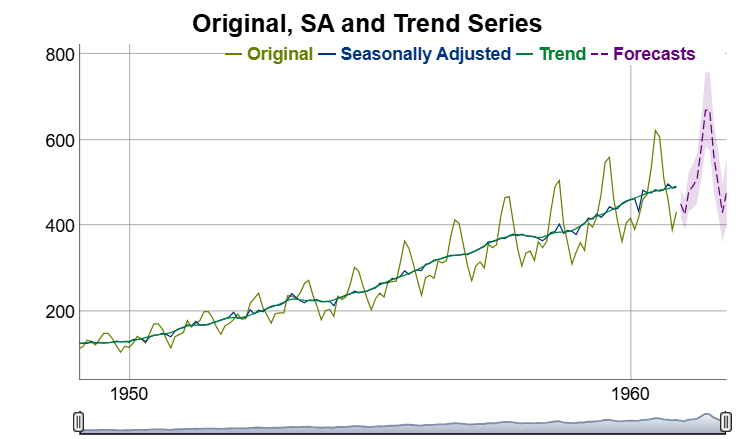

<!-- README.md is generated from README.Rmd. Please edit that file -->

```{r setup, include = FALSE}
knitr::opts_chunk$set(
  collapse = TRUE,
  comment = "#>",
  fig.path = "man/figures/README-",
  out.width = "90%"
)
```
# persephone3

[](https://github.com/statistikat/persephone3/actions)
[](https://www.tidyverse.org/lifecycle/#experimental)
[](https://github.com/statistikat/persephone3)
[](https://github.com/statistikat/persephone3/commits/master)
[](https://app.codecov.io/gh/statistikat/persephone3?branch=master)


Object oriented seasonal adjustment with two engines: the default backend is
the compiled native engine provided by `rkalos` (no Java required); the reference backend built on the
[rjdverse](https://github.com/rjdverse/) packages `rjd3x13` and `rjd3tramoseats` (java library
[JDemetra+](https://jdemetra-new-documentation.netlify.app/)) remains fully supported through explicit
`backend = "rjd3"`. The package focuses on batch processing, hierarchical time series and analytic charts.

As of 2026-11-25 (item 27, decision 397cfe8) `native` is the default backend: objects constructed
without a `backend` argument run without Java. Every fit records its engine, so objects created before
the cutover keep their recorded `rjd3` engine.

## Installation

The following commands install `persephone3`; the default native backend needs no Java.
The [rjdverse](https://github.com/rjdverse/) packages that talk with the java interface are optional
and only needed for the reference backend (`backend = "rjd3"`).

``` r
# install the package from GitHub
remotes::install_github("statistikat/persephone3")

# optional, only for the reference backend backend = "rjd3" (all on CRAN)
install.packages(c("rjd3toolkit", "rjd3x13", "rjd3tramoseats"))
```

## Usage

Objects can be constructed with `perX13()` or `perTramo()`; without a `backend`
argument they use the default native backend. Subsequently, the `run()` method runs the
model. With `backend = "rjd3"` the `output` field gives access to the output object from
`rjd3x13::x13_fast()` or `rjd3tramoseats::tramoseats_fast()`.

```{r, message = FALSE}
library(persephone3)
```
```{r}
# reference-backend object: the example below prints the rjd3 output slots
obj <- perX13(AirPassengers, backend = "rjd3")

# run the model
obj$run()

# access the preprocessing slot of the rjd3 output object
obj$output$preprocessing
```

```{r, message = FALSE, eval = FALSE}
# visualize the results
obj$plot()
```



## Native X-13

The native backend is the default since 2026-11-25, so the `backend = "native"`
argument in the examples below is optional.

For stock monthly X-13 estimation, use
`perX13(series, template, backend = "native")` with `"rsa0"`, `"rsa1"`
or `"rsa2c"` and call `$run()`. All three estimate the airline coefficients and select X-11 filters.
RSA1 also selects the transformation and outliers. RSA2c additionally tests working days, leap year and Easter. The fitted object
returns its likelihood, dated residuals, independence and normality tests,
final components and twelve-month original-series forecast intervals.

## Native TRAMO-SEATS

For a complete monthly series, the native RSA0 route estimates the airline model
and decomposes it with SEATS. It runs without Java and defaults to 24 forecast
months.

```r
x <- perTramo(AirPassengers, "rsa0", backend = "native")
x$run()
x$adjusted
x$forecasts$points$t
x$forecasts$standard_errors$y
x$result$seats_forecast_standard_errors$t
```

The original-series chart uses the TRAMO model forecast standard errors. The
last field gives the conditional SEATS standard errors for the trend.
The dated preprocessing residuals and their standard error are available in
`x$result$diagnostics$residuals`. Use `x$plotResiduals("acf")` to inspect their
autocorrelation.

## Further reading

This section still needs an update to persephone3.

More information can be found on the [github-pages site] for persephone.

* An overview of the package is available in the [useR!2019 slides].
* The [plotting vignette] contains examples of interactive plots htat can be
  created with `persephone`.
* More information about hierarchical time series can be found in the
  [hierarchical timeseries vignette].

[rjdverse]: https://github.com/rjdverse
[github-pages site]: https://statistikat.github.io/persephone3/
[plotting vignette]: https://statistikat.github.io/persephone3/articles/persephone-plotting.html
[hierarchical timeseries vignette]: https://statistikat.github.io/persephone3/articles/persephone-hierarchical.html
