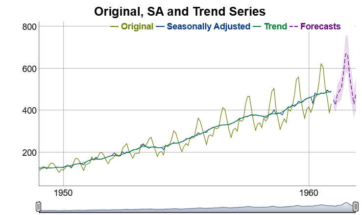

<!-- README.md is generated from README.Rmd. Please edit that file -->


# persephone3

[](https://github.com/statistikat/persephone3/actions)
[](https://www.tidyverse.org/lifecycle/#experimental)
[](https://github.com/statistikat/persephone3)
[](https://github.com/statistikat/persephone3/commits/master)
[](https://app.codecov.io/gh/statistikat/persephone3?branch=master)


Object oriented wrapper around the seasonal adjustment packages in the [rjdverse](https://github.com/rjdverse/).
The package performs time series adjustments with the java library [JDemetra+](https://jdemetra-new-documentation.netlify.app/) and focuses on batch processing,
hierarchical time series and analytic charts.

## Installation

The following commands install `persephone3` as well as the packages from the [rjdverse](https://github.com/rjdverse/) that talk with the java interface.

``` r
# install dependencies (all on CRAN)
install.packages(c("rjd3toolkit", "rjd3x13", "rjd3tramoseats"))

# install the package from GitHub
remotes::install_github("statistikat/persephone3")
```

## Usage

Objects can be constructed with `perX13()` or `perTramo()`. Subsequently,
the `run()` method runs the model and `output` gives access to the output object from
`rjd3x13::x13_fast()` or `rjd3tramoseats::tramoseats_fast()`.


``` r
library(persephone3)
```

``` r
# construct a seasonal adjustment object for the AirPassengers dataset
obj <- perX13(AirPassengers)

# run the model
obj$run()

# access the preprocessing slot of the rjd3 output object
obj$output$preprocessing
#> Log-transformation: yes 
#> SARIMA model: (0,1,1) (0,1,1)
#> 
#> SARIMA coefficients:
#>  theta(1) btheta(1) 
#>   -0.4018   -0.5569 
#> 
#> No regression variables
#> 
#> For a more detailed output, use the 'summary()' function.
```


``` r
# visualize the results
obj$plot()
```



## Native X-13

For stock monthly X-13 estimation, use
`perX13(series, template, backend = "native")` with `"rsa0"`, `"rsa1"`
or `"rsa2c"` and call `$run()`. All three estimate the airline coefficients and select X-11 filters.
RSA1 also selects the transformation and outliers. RSA2c additionally tests working days, leap year and Easter. The fitted object
returns its likelihood, dated residuals, final components and the stock
twelve-month forecasts.

## Native TRAMO-SEATS

The native monthly RSA1 route estimates the log or level transformation and
detects outliers before SEATS decomposition. Use
`perTramo(series, "rsa1", backend = "native")` and call `$run()`.
Its `$result$model$outliers` lists the fitted coefficients and positions.
The original-series forecast intervals use its fitted TR1 standard errors.

The native RSA3 route identifies SARIMA orders and returns components, point
forecasts, dated original-series forecast errors, residuals and estimated
outliers. Identification supports seasonal restarts, fourth-pass mean
refits, reduced outlier thresholds and repeated reference comparisons.
When the fitted model has no stochastic seasonal component, its final
seasonal factor is neutral and conditional seasonal uncertainty is unavailable.

Use `perTramo(series, "rsafull", backend = "native")` to select trading days,
leap year and Easter effects alongside the SARIMA model and outliers.
The fitted object’s `$getRegressors()` method reports the calendar coefficients. The result
contains the observed and forecast calendar effects on the original
series scale, and the quality report identifies the selected calendar terms.

For a complete monthly series, the native RSA0 route estimates the airline model
and decomposes it with SEATS. It runs without Java and defaults to 24 forecast
months.

```r
x <- perTramo(AirPassengers, "rsa0", backend = "native")
x$run()
x$adjusted
x$forecasts$points$t
x$forecasts$standard_errors$y
x$result$seats_forecast_standard_errors$t
```

The original-series chart uses the TRAMO model forecast standard errors. The
last field gives the conditional SEATS standard errors for the trend.
The dated preprocessing residuals and their standard error are available in
`x$result$diagnostics$residuals`. Use `x$plotResiduals("acf")` to inspect their
autocorrelation.

## Further reading

This section still needs an update to persephone3.

More information can be found on the [github-pages site] for persephone.

* An overview of the package is available in the [useR!2019 slides].
* The [plotting vignette] contains examples of interactive plots htat can be
  created with `persephone`.
* More information about hierarchical time series can be found in the
  [hierarchical timeseries vignette].

[rjdverse]: https://github.com/rjdverse
[github-pages site]: https://statistikat.github.io/persephone3/
[plotting vignette]: https://statistikat.github.io/persephone3/articles/persephone-plotting.html
[hierarchical timeseries vignette]: https://statistikat.github.io/persephone3/articles/persephone-hierarchical.html
