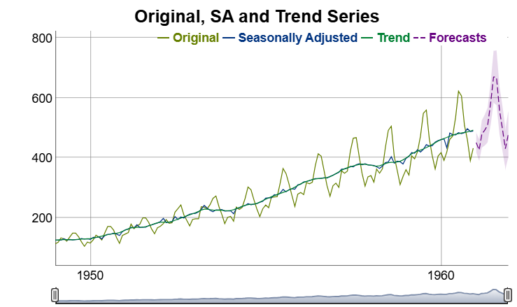

# persephone3

[](https://github.com/statistikat/persephone3/actions)
[](https://www.tidyverse.org/lifecycle/#experimental)
[](https://github.com/statistikat/persephone3)
[](https://github.com/statistikat/persephone3/commits/master)
[](https://app.codecov.io/gh/statistikat/persephone3?branch=master)

Object oriented wrapper around the seasonal adjustment packages in the
[rjdverse](https://github.com/rjdverse/). The package performs time
series adjustments with the java library
[JDemetra+](https://jdemetra-new-documentation.netlify.app/) and focuses
on batch processing, hierarchical time series and analytic charts.

## Installation

The following commands install `persephone3` as well as the packages
from the [rjdverse](https://github.com/rjdverse/) that talk with the
java interface.

``` r

# install dependencies
remotes::install_github("rjdverse/rjd3toolkit@*release")
remotes::install_github("rjdverse/rjd3x13@*release")
remotes::install_github("rjdverse/rjd3tramoseats@*release")

# install the package from GitHub
remotes::install_github("statistikat/persephone3")
```

## Usage

Objects can be constructed with
[`perX13()`](https://statistikat.github.io/persephone3/reference/perX13.md)
or
[`perTramo()`](https://statistikat.github.io/persephone3/reference/perTramo.md).
Subsequently, the `run()` method runs the model and `output` gives
access to the output object from
[`rjd3x13::x13_fast()`](https://rjdverse.github.io/rjd3x13/reference/x13.html)
or
[`rjd3tramoseats::tramoseats_fast()`](https://rjdverse.github.io/rjd3tramoseats/reference/tramoseats.html).

``` r

library(persephone3)
```

``` r

# construct a seasonal adjustment object for the AirPassengers dataset
obj <- perX13(AirPassengers)

# run the model
obj$run()

# access the preprocessing slot of the rjd3 output object
obj$output$preprocessing
#> Log-transformation: yes 
#> SARIMA model: (0,1,1) (0,1,1)
#> 
#> SARIMA coefficients:
#>  theta(1) btheta(1) 
#>   -0.4018   -0.5569 
#> 
#> No regression variables
#> 
#> For a more detailed output, use the 'summary()' function.
```

``` r

# visualize the results
obj$plot()
```



## Further reading

This section still needs an update to persephone3.

More information can be found on the [github-pages
site](https://statistikat.github.io/persephone3/) for persephone.

- An overview of the package is available in the \[useR!2019 slides\].
- The [plotting
  vignette](https://statistikat.github.io/persephone3/articles/persephone-plotting.html)
  contains examples of interactive plots htat can be created with
  `persephone`.
- More information about hierarchical time series can be found in the
  [hierarchical timeseries
  vignette](https://statistikat.github.io/persephone3/articles/persephone-hierarchical.html).
